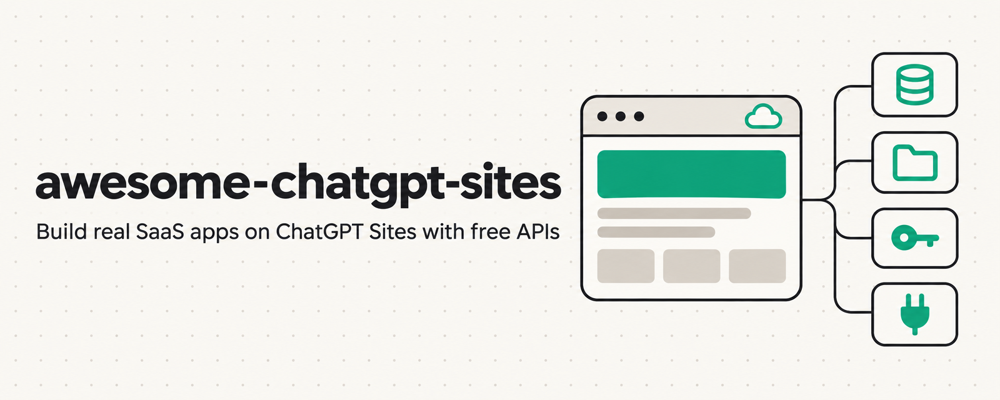
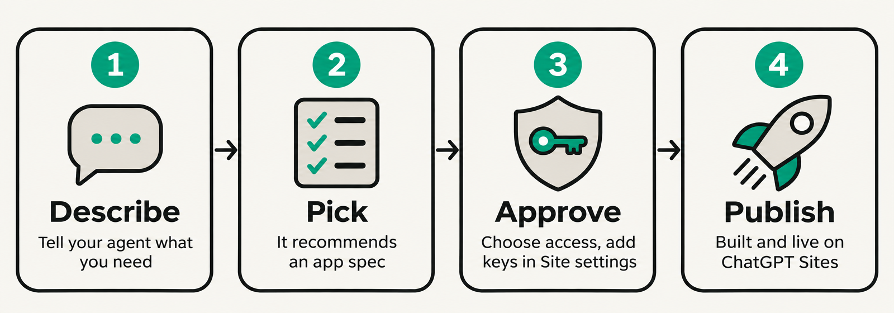
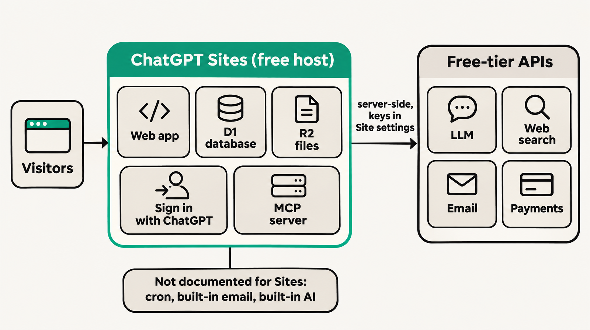

<p align="center">
  
</p>

<p align="center"><a href="README.md">English</a> | <a href="README.ko.md">한국어</a> | <b>日本語</b> | <a href="README.zh-CN.md">简体中文</a></p>

<p align="center">
  
  
  
  <a href="CONTRIBUTING.md"></a>
</p>

**必要なSaaSをコーディングエージェントに伝えるだけ。用意済みの仕様を選び、無料APIキーの取得まで案内し、ChatGPT Sitesに公開します。**

[ChatGPT Sites](https://learn.chatgpt.com/docs/sites)向けのアプリ制作スキル集です。SitesはChatGPTとCodexで作ったサイトをホスティングするOpenAIのサービスです。（ChatGPTのミラーサイト一覧ではありません。）

## クイックスタート：インストールはエージェントに任せる

以下をCodex（または公式Sitesスキルのあるエージェント）にそのまま貼り付けてください。インストールはエージェントが行います。 プロンプトは英語のまま貼り付けて問題ありません。

```text
Install the "awesome-sites" skill from https://github.com/Atipico1/awesome-chatgpt-sites into this agent.

1. Clone the repository into a temporary folder.
2. Copy only the folder skills/awesome-sites into this agent's skills directory
   (Codex: ~/.codex/skills/, Claude Code: ~/.claude/skills/). Keep its references/ folder inside it.
3. Confirm that <skills directory>/awesome-sites/SKILL.md and awesome-sites/references/apps/ exist, then delete the temporary clone.
4. Check that the official ChatGPT Sites skill or plugin is available to this agent.
   If it is not, tell me how to enable it and stop.
5. Tell me whether I must restart the agent to load new skills, and show me one example request to try.
```

### 次に、欲しいものを伝える

欲しいツールを普段の言葉で説明します。例：

- "自分のSaaS用のフィードバックボードをSitesで作って。"
- "Sitesで無料で作れるものは何？"
- "会議の録音からアクションアイテムを作るツールを作って。"

## 仕組み

<p align="center">
  
</p>

1. **必要なことを説明します。** スキルが下の仕様から合うものを選び、運用コストを伝えます。
2. **作る前に確認します。** サイトを誰が開けるか、必要なログイン、カスタムドメイン、使うAPIキー、訪問者データの保存範囲を承認します。
3. **キー取得を手順どおりに案内します**（リンク、操作、シークレット名）。キーはチャットではなくサイトの設定に入れます。
4. **公式Sitesスキルが構築・公開します。** 仕様がデータモデル、ルート、画面、上限、検証手順を固定します。

## アプリ一覧

仕様は31個。それぞれ[`skills/awesome-sites/references/apps/`](skills/awesome-sites/references/apps/)内のファイル1つです。「必要なキー」はSites以外に必要なもので、すべて無料枠で始められます。

### 顧客向けツール

| アプリ | できること | 必要なキー |
| --- | --- | --- |
| [feedback-board](skills/awesome-sites/references/apps/feedback-board.md) | お客様が機能要望を投稿・投票できるボードと公開ロードマップ | — |
| [waitlist](skills/awesome-sites/references/apps/waitlist.md) | リリース前のメール登録。紹介リンクで順位が上がる | — |
| [changelog](skills/awesome-sites/references/apps/changelog.md) | RSSと埋め込みウィジェット付きのリリースノート | — |
| [form-backend](skills/awesome-sites/references/apps/form-backend.md) | フォームビルダーと受信箱。任意のHTMLフォームから受付 | — |
| [testimonials](skills/awesome-sites/references/apps/testimonials.md) | お客様の声を集めて「Wall of Love」で表示 | — |
| [booking](skills/awesome-sites/references/apps/booking.md) | 空き時間を設定し、相手が日時を選んで予約（カレンダー連携なし） | — |
| [link-shortener](skills/awesome-sites/references/apps/link-shortener.md) | クリック統計とQRコード付きの短縮リンク | — |
| [link-in-bio](skills/awesome-sites/references/apps/link-in-bio.md) | テーマとクリック統計付きのリンクまとめページ | — |
| [email-signature](skills/awesome-sites/references/apps/email-signature.md) | コピー＆ペーストできるHTMLメール署名ジェネレーター（チームモード付き） | — |

### ファイルと決済

| アプリ | できること | 必要なキー |
| --- | --- | --- |
| [file-transfer](skills/awesome-sites/references/apps/file-transfer.md) | ファイルをアップロードし、期限・パスワード付きリンクで共有 | — |
| [doc-sharing](skills/awesome-sites/references/apps/doc-sharing.md) | 追跡できるPDFリンク。誰がどのページを何秒見たか確認 | — |
| [invoicing](skills/awesome-sites/references/apps/invoicing.md) | 公開支払いページとStripe Checkout付きの請求書 | Stripe |
| [digital-storefront](skills/awesome-sites/references/apps/digital-storefront.md) | PDFやテンプレートなどのデジタル商品をStripeで販売 | Stripe |

### AI・Webデータツール

| アプリ | できること | 必要なキー |
| --- | --- | --- |
| [formula-ai](skills/awesome-sites/references/apps/formula-ai.md) | 日本語や英語の説明からExcel/スプレッドシートの数式・SQL・正規表現を生成 | LLM |
| [research-briefs](skills/awesome-sites/references/apps/research-briefs.md) | Web検索して出典付きのレポートを作成 | Tavily + LLM |
| [csv-enricher](skills/awesome-sites/references/apps/csv-enricher.md) | Web検索でCSVの新しい列を埋める | Tavily + LLM |
| [bookmarks-mcp](skills/awesome-sites/references/apps/bookmarks-mcp.md) | AI要約付きブックマーク。MCP経由でChatGPTから検索 | — (LLM optional) |
| [meeting-notes](skills/awesome-sites/references/apps/meeting-notes.md) | 音声から文字起こし・要約・アクションアイテムを作成 | Groq + LLM |
| [resume-tailor](skills/awesome-sites/references/apps/resume-tailor.md) | 求人票に合わせて履歴書とカバーレターを調整 | LLM |
| [docs-chatbot](skills/awesome-sites/references/apps/docs-chatbot.md) | 自社ドキュメントで答えるサポートチャットボット（埋め込み可） | LLM |
| [seo-audit](skills/awesome-sites/references/apps/seo-audit.md) | PageSpeedスコアとオンページSEOチェックリスト | PageSpeed key |
| [receipt-tracker](skills/awesome-sites/references/apps/receipt-tracker.md) | レシート写真を経費台帳に。CSV出力あり | Gemini key |
| [feedback-analyzer](skills/awesome-sites/references/apps/feedback-analyzer.md) | レビューやアンケートをテーマと感情で分類 | LLM |
| [snippet-library](skills/awesome-sites/references/apps/snippet-library.md) | 変数付きの定型文・プロンプト保存庫（MCP対応） | — (LLM optional) |
| [review-reply-drafter](skills/awesome-sites/references/apps/review-reply-drafter.md) | 顧客レビューを貼ると返信案を3つ作成（自動投稿なし） | LLM |

### 韓国市場向けツール（UIは韓国語）

| アプリ | できること | 必要なキー |
| --- | --- | --- |
| [group-order-ledger](skills/awesome-sites/references/apps/group-order-ledger.md) | KakaoTalkの共同購入チャットを注文表に整理し入金照合（記録のみ） | LLM |
| [order-sheet-converter](skills/awesome-sites/references/apps/order-sheet-converter.md) | マーケットの注文Excelを宅配アップロード形式に変換（ブラウザ内のみ） | — |
| [campaign-tracker](skills/awesome-sites/references/apps/campaign-tracker.md) | 体験団・協賛キャンペーンの締切管理とカレンダー購読 | — (LLM optional) |
| [club-ledger](skills/awesome-sites/references/apps/club-ledger.md) | サークルの会費・出席・罰金・ランキング記録（お金は扱わない） | — |

### チーム・エージェント向けツール

| アプリ | できること | 必要なキー |
| --- | --- | --- |
| [issue-tracker](skills/awesome-sites/references/apps/issue-tracker.md) | MCPツール付きのLinear風イシューボード | — |
| [memory-mcp](skills/awesome-sites/references/apps/memory-mcp.md) | ChatGPTとCodexがMCPで読み書きできる個人メモリ | — |

## Sitesが提供するものと、自分で用意するもの

<p align="center">
  
</p>

Sitesは無料のホスティング、データベース（D1）、ファイル保管（R2）、ログイン（Sign in with ChatGPT）、MCPサーバーを提供します。AI・検索・メール・決済は無料枠のある外部APIをサーバーから呼び出し、キーはサイトの設定に保管します。定期実行（cron）、組み込みメール、組み込みAIはSitesのドキュメントにないため、どの仕様もそれらに依存しません。

### 案内できる無料APIキー

| サービス | 用途 | 無料枠（2026-11確認） | キー取得 |
| --- | --- | --- | --- |
| Groq | LLM、音声認識 | 大型モデルで1日約1,000リクエスト、Whisperは1時間あたり約7,200秒 | [console.groq.com/keys](https://console.groq.com/keys) |
| Gemini | LLM、レシート画像認識 | 一部モデルのみ無料、1日の上限は小さい。無料枠の入力はGoogleが利用する場合あり | [aistudio.google.com/apikey](https://aistudio.google.com/apikey) |
| Cloudflare Workers AI | LLM、埋め込み | 1日10,000ニューロン | [dash.cloudflare.com](https://dash.cloudflare.com) |
| Tavily | Web検索 | 月1,000クレジット | [app.tavily.com](https://app.tavily.com) |
| Jina Reader | URLをMarkdownに | キーなしでも低いレート制限で利用可 | [jina.ai/reader](https://jina.ai/reader/) |
| PageSpeed Insights | SEO診断 | 無料、キー必須、通常1日25,000回 | [Google Cloud Console](https://console.cloud.google.com) |
| Resend | メール（任意） | 月3,000通、1日100通。他の宛先に送るにはドメイン認証が必要 | [resend.com/api-keys](https://resend.com/api-keys) |
| Stripe | 決済 | まずテストモード。本番キーへの切り替えはご自身で | [dashboard.stripe.com/apikeys](https://dashboard.stripe.com/apikeys) |

上限は頻繁に変わります。詳しい手順、シークレット名、動作確認の呼び出しは[`api-keys.md`](skills/awesome-sites/references/shared/api-keys.md)にあります。

## 必要なもの

- 公式**Sites**スキルまたはプラグインのあるエージェント（Codex向けに作成）
- Sitesが使えるChatGPTプラン：Plus、Pro、または対象のワークスペース。FreeとGoは不可

## 手動インストール

自分でインストールする場合：

<details>
<summary><b>Codex</b></summary>

```bash
git clone https://github.com/Atipico1/awesome-chatgpt-sites.git
cp -R awesome-chatgpt-sites/skills/awesome-sites ~/.codex/skills/
```

</details>

<details>
<summary><b>Claude Code（Sitesツールが使えること）</b></summary>

```bash
git clone https://github.com/Atipico1/awesome-chatgpt-sites.git
cp -R awesome-chatgpt-sites/skills/awesome-sites ~/.claude/skills/
```

</details>

<details>
<summary><b>Skills CLI</b></summary>

```bash
npx skills add Atipico1/awesome-chatgpt-sites --skill awesome-sites
```
`awesome-sites`フォルダ全体をコピーしてください。スキルは自身の`references/`フォルダのファイルを読みます。

</details>

## 現状

仕様は作成とリント（`python3 scripts/lint-specs.py`）まで完了しています。すべての仕様を実際のSiteで最後まで作ったわけではありません。各仕様は充実した初稿として扱ってください。実際に作った結果の報告やPRが最も役立ちます。

## よくある質問

<details>
<summary><b>お金はかかりますか？</b></summary>

Sitesのホスティングは2026-12-31まで無料です。2027-01-01以降、データベースのあるサイトはトラフィック前に月約25クレジットを使います（Plusの枠は125）。表のAPIはすべて無料枠があり、無料枠は訪問者全員で共有されるため、仕様にユーザー別の上限とキャッシュを入れています。

</details>

<details>
<summary><b>サイトで自分のChatGPTサブスクのAIを使えますか？</b></summary>

ドキュメント上、Sitesでは使えません。Sign in with ChatGPTが渡すのは訪問者のメールと名前だけです。アプリはご自身で取得したキーで外部の無料LLMを呼び出します。

</details>

<details>
<summary><b>APIキーはどこに入れますか？</b></summary>

サイトの設定（ChatGPT → Sites → 該当サイト → その他の操作 → 設定）です。Sitesのガイダンスはシークレットをプロンプトやファイルに置かないよう求めています。正確なシークレット名はスキルが伝えます。

</details>

<details>
<summary><b>お客様はChatGPTアカウントなしで使えますか？</b></summary>

サイトの公開範囲を「公開」にすれば可能です。スキルは作成前に確認し、公開範囲を勝手に変更しません。ログインが必要な機能はChatGPTアカウントでのみログインできます。

</details>

<details>
<summary><b>なぜ仕様がここまで詳しいのですか？</b></summary>

エージェントが製品の挙動を勝手に決めないよう、テーブル・ルート・上限・検証手順を仕様に固定しているためです。

</details>

## コントリビュート

実際の需要があり、Sitesに適合し、無料枠で動く新しいアプリ仕様を歓迎します。[CONTRIBUTING.md](CONTRIBUTING.md)を読み、PRの前に`python3 scripts/lint-specs.py`を実行してください。各アプリが入った理由と見送ったアイデアは[docs/demand-evidence.md](docs/demand-evidence.md)にあります。

## リファレンス

- [仕様テンプレート](skills/awesome-sites/references/shared/spec-template.md)
- [プラットフォームの基本ルール](skills/awesome-sites/references/shared/baseline.md)
- [公開範囲・ログイン・カスタムドメイン](skills/awesome-sites/references/shared/access-and-domains.md)
- [無料API利用量の保護](skills/awesome-sites/references/shared/usage-guard.md)
