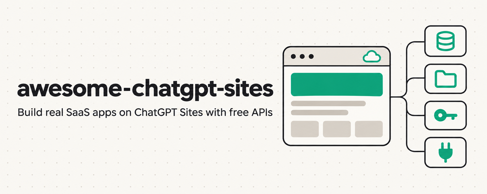
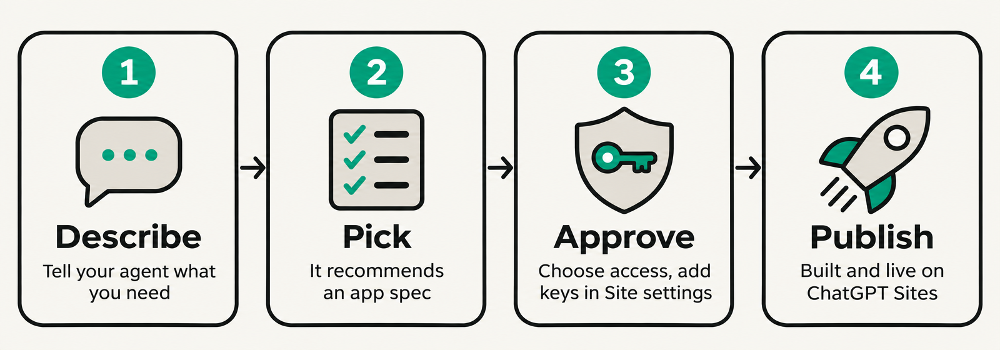
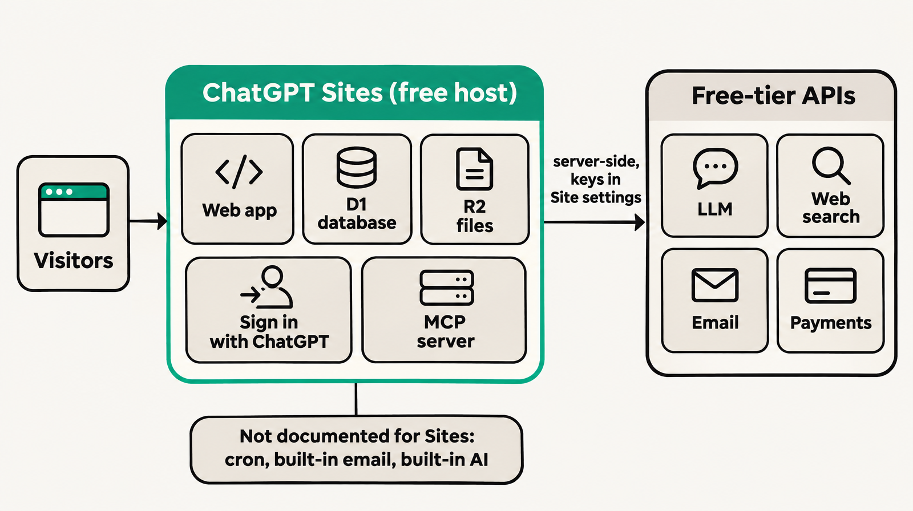

<p align="center">
  
</p>

<p align="center"><a href="README.md">English</a> | <b>한국어</b> | <a href="README.ja.md">日本語</a> | <a href="README.zh-CN.md">简体中文</a></p>

<p align="center">
  
  
  
  <a href="CONTRIBUTING.md"></a>
</p>

**필요한 SaaS를 코딩 에이전트에게 말하면, 준비된 스펙을 골라 무료 API 키 발급까지 안내하고 ChatGPT Sites에 배포합니다.**

[ChatGPT Sites](https://learn.chatgpt.com/docs/sites)용 앱 제작 스킬 모음입니다. Sites는 ChatGPT와 Codex에서 만든 사이트를 호스팅하는 OpenAI 서비스입니다. (ChatGPT 미러 사이트 목록이 아닙니다.)

## 빠른 시작: 에이전트에게 설치를 맡기기

아래를 Codex(또는 공식 Sites 스킬이 있는 에이전트)에 그대로 붙여 넣으세요. 설치는 에이전트가 합니다. 프롬프트는 영어 그대로 붙여 넣으면 됩니다.

```text
Install the "awesome-sites" skill from https://github.com/Atipico1/awesome-chatgpt-sites into this agent.

1. Clone the repository into a temporary folder.
2. Copy only the folder skills/awesome-sites into this agent's skills directory
   (Codex: ~/.codex/skills/, Claude Code: ~/.claude/skills/). Keep its references/ folder inside it.
3. Confirm that <skills directory>/awesome-sites/SKILL.md and awesome-sites/references/apps/ exist, then delete the temporary clone.
4. Check that the official ChatGPT Sites skill or plugin is available to this agent.
   If it is not, tell me how to enable it and stop.
5. Tell me whether I must restart the agent to load new skills, and show me one example request to try.
```

### 그다음 필요한 걸 말하기

원하는 도구를 평소 말투로 설명하면 됩니다. 예:

- "내 SaaS용 피드백 보드를 Sites에 만들어줘."
- "Sites로 무료로 만들 수 있는 게 뭐가 있어?"
- "카톡 공동구매 주문을 정리하고 입금을 대조하는 도구를 만들어줘."

## 작동 방식

<p align="center">
  
</p>

1. **필요한 걸 설명합니다.** 스킬이 아래 스펙 중 맞는 것을 고르고 운영 비용을 알려 줍니다.
2. **만들기 전에 허락을 받습니다.** 누가 사이트를 열 수 있는지, 어떤 로그인이 필요한지, 커스텀 도메인, 쓸 API 키, 방문자 데이터 저장 범위를 승인합니다.
3. **키 발급을 단계별로 안내합니다**(링크, 클릭 순서, 시크릿 이름). 키는 채팅이 아니라 사이트 설정에 넣습니다.
4. **공식 Sites 스킬이 만들고 배포합니다.** 스펙이 데이터 모델, 경로, 화면, 한도, 검증 절차를 고정해 둡니다.

## 앱 목록

스펙 31개입니다. 각각 [`skills/awesome-sites/references/apps/`](skills/awesome-sites/references/apps/)의 파일 하나입니다. "필요한 키"는 Sites 외에 필요한 키이며, 모두 무료 티어로 시작할 수 있습니다.

### 고객용 도구

| 앱 | 하는 일 | 필요한 키 |
| --- | --- | --- |
| [feedback-board](skills/awesome-sites/references/apps/feedback-board.md) | 고객이 기능 요청을 올리고 투표하는 게시판과 공개 로드맵 | — |
| [waitlist](skills/awesome-sites/references/apps/waitlist.md) | 출시 전 이메일 대기자 모집, 추천 링크로 순위 상승 | — |
| [changelog](skills/awesome-sites/references/apps/changelog.md) | RSS와 임베드 위젯이 있는 릴리즈 노트 페이지 | — |
| [form-backend](skills/awesome-sites/references/apps/form-backend.md) | 폼 빌더와 제출함, 어떤 HTML 폼이든 받음 | — |
| [testimonials](skills/awesome-sites/references/apps/testimonials.md) | 고객 후기를 모아 "Wall of Love"로 보여줌 | — |
| [booking](skills/awesome-sites/references/apps/booking.md) | 가능 시간을 열어두면 상대가 시간을 골라 예약(캘린더 연동 없음) | — |
| [link-shortener](skills/awesome-sites/references/apps/link-shortener.md) | 클릭 통계와 QR이 있는 단축 링크 | — |
| [link-in-bio](skills/awesome-sites/references/apps/link-in-bio.md) | 링크 모음 공개 페이지, 테마와 클릭 통계 | — |
| [email-signature](skills/awesome-sites/references/apps/email-signature.md) | 복사해서 붙이는 HTML 이메일 서명 생성기, 팀 모드 지원 | — |

### 파일과 결제

| 앱 | 하는 일 | 필요한 키 |
| --- | --- | --- |
| [file-transfer](skills/awesome-sites/references/apps/file-transfer.md) | 파일을 올리고 만료·비밀번호가 있는 링크로 공유 | — |
| [doc-sharing](skills/awesome-sites/references/apps/doc-sharing.md) | 추적 가능한 PDF 링크, 누가 얼마나 봤는지 확인 (DocSend형) | — |
| [invoicing](skills/awesome-sites/references/apps/invoicing.md) | 공개 결제 페이지와 Stripe Checkout이 있는 청구서 | Stripe |
| [digital-storefront](skills/awesome-sites/references/apps/digital-storefront.md) | PDF·템플릿 같은 디지털 상품을 Stripe로 판매 | Stripe |

### AI·웹 데이터 도구

| 앱 | 하는 일 | 필요한 키 |
| --- | --- | --- |
| [formula-ai](skills/awesome-sites/references/apps/formula-ai.md) | 말로 설명하면 엑셀/시트 수식·SQL·정규식을 만들어 줌 | LLM |
| [research-briefs](skills/awesome-sites/references/apps/research-briefs.md) | 웹 검색 후 출처가 달린 리포트 작성 | Tavily + LLM |
| [csv-enricher](skills/awesome-sites/references/apps/csv-enricher.md) | CSV의 새 칸을 웹 검색으로 채움 | Tavily + LLM |
| [bookmarks-mcp](skills/awesome-sites/references/apps/bookmarks-mcp.md) | AI 요약이 붙는 북마크, MCP로 ChatGPT에서 검색 | — (LLM optional) |
| [meeting-notes](skills/awesome-sites/references/apps/meeting-notes.md) | 회의 녹음을 받아쓰기·요약·액션 아이템으로 | Groq + LLM |
| [resume-tailor](skills/awesome-sites/references/apps/resume-tailor.md) | 채용공고에 맞춰 이력서와 커버레터를 다시 써 줌 | LLM |
| [docs-chatbot](skills/awesome-sites/references/apps/docs-chatbot.md) | 내 문서로 답하는 고객지원 챗봇, 사이트에 임베드 | LLM |
| [seo-audit](skills/awesome-sites/references/apps/seo-audit.md) | PageSpeed 점수와 온페이지 SEO 체크리스트 | PageSpeed key |
| [receipt-tracker](skills/awesome-sites/references/apps/receipt-tracker.md) | 영수증 사진을 경비 장부로, CSV 내보내기 | Gemini key |
| [feedback-analyzer](skills/awesome-sites/references/apps/feedback-analyzer.md) | 리뷰·설문 응답을 주제와 감정으로 묶어 분석 | LLM |
| [snippet-library](skills/awesome-sites/references/apps/snippet-library.md) | 변수가 있는 문구·프롬프트 저장소, MCP 연동 | — (LLM optional) |
| [review-reply-drafter](skills/awesome-sites/references/apps/review-reply-drafter.md) | 고객 리뷰를 붙여넣으면 답글 초안 3개 (자동 게시 없음) | LLM |

### 한국 시장용 도구 (UI 한국어)

| 앱 | 하는 일 | 필요한 키 |
| --- | --- | --- |
| [group-order-ledger](skills/awesome-sites/references/apps/group-order-ledger.md) | 카톡 공동구매 대화를 주문표로 정리, 입금 대조 (기록 전용) | LLM |
| [order-sheet-converter](skills/awesome-sites/references/apps/order-sheet-converter.md) | 마켓 주문 엑셀을 택배 업로드 양식으로 변환 (브라우저에서만 처리) | — |
| [campaign-tracker](skills/awesome-sites/references/apps/campaign-tracker.md) | 체험단·협찬 일정 관리와 캘린더 구독 피드 | — (LLM optional) |
| [club-ledger](skills/awesome-sites/references/apps/club-ledger.md) | 동호회 회비·출석·벌금·랭킹 기록 (돈은 다루지 않음) | — |

### 팀·에이전트용 도구

| 앱 | 하는 일 | 필요한 키 |
| --- | --- | --- |
| [issue-tracker](skills/awesome-sites/references/apps/issue-tracker.md) | MCP 도구가 있는 Linear 스타일 이슈 보드 | — |
| [memory-mcp](skills/awesome-sites/references/apps/memory-mcp.md) | ChatGPT·Codex가 MCP로 읽고 쓰는 개인 메모리 | — |

## Sites가 주는 것과 직접 가져오는 것

<p align="center">
  
</p>

Sites는 무료 호스팅, 데이터베이스(D1), 파일 저장소(R2), 로그인(Sign in with ChatGPT), MCP 서버를 제공합니다. AI, 검색, 이메일, 결제는 무료 티어가 있는 외부 API를 서버에서 호출하고, 키는 사이트 설정에 보관합니다. 예약 작업(크론), 내장 이메일, 내장 AI는 Sites 문서에 없어서 어떤 스펙도 이에 의존하지 않습니다.

### 안내해 주는 무료 API 키

| 서비스 | 용도 | 무료 한도 (2026-11 확인) | 키 발급 |
| --- | --- | --- | --- |
| Groq | LLM, 음성 인식 | 대형 모델 하루 약 1,000회, Whisper 시간당 약 7,200초 | [console.groq.com/keys](https://console.groq.com/keys) |
| Gemini | LLM, 영수증 이미지 인식 | 일부 모델만 무료, 일일 한도 작음. 무료 입력은 Google이 활용할 수 있음 | [aistudio.google.com/apikey](https://aistudio.google.com/apikey) |
| Cloudflare Workers AI | LLM, 임베딩 | 하루 10,000 뉴런 | [dash.cloudflare.com](https://dash.cloudflare.com) |
| Tavily | 웹 검색 | 월 1,000 크레딧 | [app.tavily.com](https://app.tavily.com) |
| Jina Reader | URL을 마크다운으로 | 키 없이 낮은 속도 제한으로 사용 가능 | [jina.ai/reader](https://jina.ai/reader/) |
| PageSpeed Insights | SEO 점검 | 무료, 키 필수, 보통 하루 25,000회 | [Google Cloud Console](https://console.cloud.google.com) |
| Resend | 이메일 (선택) | 월 3,000통, 하루 100통. 다른 수신자에게 보내려면 도메인 인증 필요 | [resend.com/api-keys](https://resend.com/api-keys) |
| Stripe | 결제 | 테스트 모드로 시작, 라이브 키는 직접 교체 | [dashboard.stripe.com/apikeys](https://dashboard.stripe.com/apikeys) |

한도는 자주 바뀝니다. 전체 절차, 시크릿 이름, 동작 확인 호출은 [`api-keys.md`](skills/awesome-sites/references/shared/api-keys.md)에 있습니다.

## 요구 사항

- 공식 **Sites** 스킬 또는 플러그인이 있는 에이전트 (Codex 기준으로 작성)
- Sites를 쓸 수 있는 ChatGPT 플랜: Plus, Pro, 또는 해당되는 워크스페이스. Free와 Go는 불가

## 직접 설치

직접 설치하려면:

<details>
<summary><b>Codex</b></summary>

```bash
git clone https://github.com/Atipico1/awesome-chatgpt-sites.git
cp -R awesome-chatgpt-sites/skills/awesome-sites ~/.codex/skills/
```

</details>

<details>
<summary><b>Claude Code (Sites 도구가 있어야 함)</b></summary>

```bash
git clone https://github.com/Atipico1/awesome-chatgpt-sites.git
cp -R awesome-chatgpt-sites/skills/awesome-sites ~/.claude/skills/
```

</details>

<details>
<summary><b>Skills CLI</b></summary>

```bash
npx skills add Atipico1/awesome-chatgpt-sites --skill awesome-sites
```
`awesome-sites` 폴더 전체를 복사해야 합니다. 스킬은 자기 `references/` 폴더의 파일을 읽습니다.

</details>

## 현재 상태

스펙은 작성과 린트(`python3 scripts/lint-specs.py`)까지 끝났습니다. 아직 모든 스펙을 실제 Site로 끝까지 만들어 보지는 않았습니다. 각 스펙을 탄탄한 초안으로 보시고, 실제로 만들어 본 결과 보고와 PR이 가장 큰 도움이 됩니다.

## 자주 묻는 질문

<details>
<summary><b>돈이 드나요?</b></summary>

Sites 호스팅은 2026-12-31까지 무료입니다. 2027-01-01부터 데이터베이스가 있는 사이트는 트래픽 전에 월 약 25크레딧을 씁니다(Plus 허용량은 125). 표의 API는 모두 무료 티어가 있고, 무료 티어는 방문자 전체가 나눠 쓰므로 스펙에 사용자별 한도와 캐시가 들어 있습니다.

</details>

<details>
<summary><b>사이트가 내 ChatGPT 구독으로 AI를 쓸 수 있나요?</b></summary>

문서상 Sites에서는 안 됩니다. Sign in with ChatGPT는 방문자의 이메일과 이름만 줍니다. 앱은 직접 발급한 키로 외부 무료 LLM을 호출합니다.

</details>

<details>
<summary><b>API 키는 어디에 넣나요?</b></summary>

사이트 설정(ChatGPT → Sites → 해당 사이트 → 더보기 → 설정)에 넣습니다. Sites 가이드가 시크릿을 프롬프트와 파일에 두지 말라고 합니다. 정확한 시크릿 이름은 스킬이 알려 줍니다.

</details>

<details>
<summary><b>고객은 ChatGPT 계정 없이 쓸 수 있나요?</b></summary>

사이트 공개 범위를 퍼블릭으로 하면 됩니다. 스킬은 만들기 전에 물어보고, 공개 범위를 마음대로 바꾸지 않습니다. 로그인이 필요한 기능은 ChatGPT 계정으로만 로그인할 수 있습니다.

</details>

<details>
<summary><b>스펙이 왜 이렇게 자세한가요?</b></summary>

에이전트가 제품 동작을 임의로 정하지 않도록, 테이블·경로·한도·검증 절차를 스펙에 고정해 두었습니다.

</details>

## 기여하기

실제 수요가 있고, Sites에 맞고, 무료 티어로 돌아가는 새 앱 스펙을 환영합니다. [CONTRIBUTING.md](CONTRIBUTING.md)를 읽고, PR 전에 `python3 scripts/lint-specs.py`를 실행하세요. 각 앱이 들어온 이유와 제외한 아이디어는 [docs/demand-evidence.md](docs/demand-evidence.md)에 있습니다.

## 참고 문서

- [스펙 템플릿](skills/awesome-sites/references/shared/spec-template.md)
- [플랫폼 기본 규칙](skills/awesome-sites/references/shared/baseline.md)
- [공개 범위·로그인·커스텀 도메인](skills/awesome-sites/references/shared/access-and-domains.md)
- [무료 API 사용량 보호](skills/awesome-sites/references/shared/usage-guard.md)
