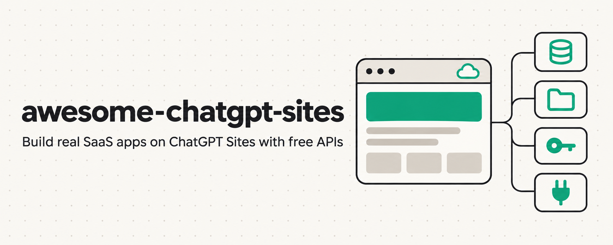
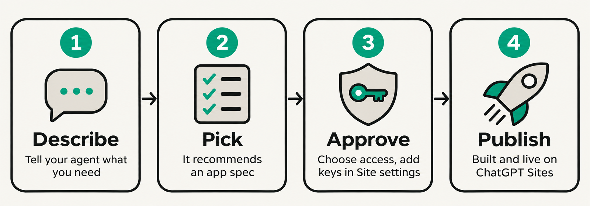
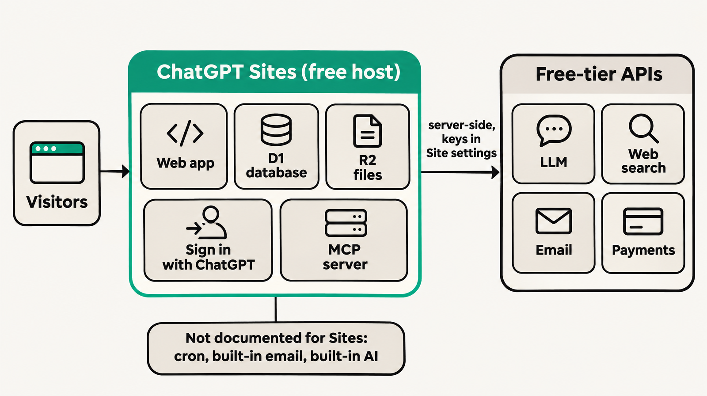

<p align="center">
  
</p>

<p align="center"><b>English</b> | <a href="README.ko.md">한국어</a> | <a href="README.ja.md">日本語</a> | <a href="README.zh-CN.md">简体中文</a></p>

<p align="center">
  
  
  
  <a href="LICENSE"></a>
  <a href="CONTRIBUTING.md"></a>
</p>

**Tell your coding agent what SaaS you need. It picks a ready-made spec, walks you through the free API keys, and ships it on ChatGPT Sites.**

App-building skills for [ChatGPT Sites](https://learn.chatgpt.com/docs/sites), OpenAI's hosting for sites built in ChatGPT and Codex. (This is not a list of ChatGPT mirror sites.)

## Quick start: let your agent install it

Paste this into Codex (or any agent that has the official Sites skill). It installs the skill for you.

```text
Install the "awesome-sites" skill from https://github.com/Atipico1/awesome-chatgpt-sites into this agent.

1. Clone the repository into a temporary folder.
2. Copy only the folder skills/awesome-sites into this agent's skills directory
   (Codex: ~/.codex/skills/, Claude Code: ~/.claude/skills/). Keep its references/ folder inside it.
3. Confirm that <skills directory>/awesome-sites/SKILL.md and awesome-sites/references/apps/ exist, then delete the temporary clone.
4. Check that the official ChatGPT Sites skill or plugin is available to this agent.
   If it is not, tell me how to enable it and stop.
5. Tell me whether I must restart the agent to load new skills, and show me one example request to try.
```

### Then ask for what you need

Describe the tool in your own words. For example:

- "I need a feedback board for my SaaS, hosted on Sites."
- "What can I build on Sites for free?"
- "Make me a tool that turns meeting recordings into action items."

## How it works

<p align="center">
  
</p>

1. **You describe a need.** The skill matches it to one of the specs below and says what it costs to run.
2. **It asks before it builds.** You approve who can open the site, what sign-in is needed, a custom domain, which API keys it will use, and what visitor data it stores.
3. **You get step-by-step key guides** (links, clicks, secret names). Keys go into the site's settings, never into chat.
4. **The official Sites skill builds and publishes it.** The spec fixes the data model, routes, screens, limits, and a verification script.

## The apps

31 specs. Each is one file in [`skills/awesome-sites/references/apps/`](skills/awesome-sites/references/apps/). "Needs" lists the keys beyond Sites itself; free tiers cover all of them.

### Customer-facing tools

| App | What it does | Needs |
| --- | --- | --- |
| [feedback-board](skills/awesome-sites/references/apps/feedback-board.md) | Customers post and vote on feature requests; public roadmap | — |
| [waitlist](skills/awesome-sites/references/apps/waitlist.md) | Pre-launch email signups; referral links move people up the list | — |
| [changelog](skills/awesome-sites/references/apps/changelog.md) | Release-notes page with RSS and an embeddable widget | — |
| [form-backend](skills/awesome-sites/references/apps/form-backend.md) | Form builder and inbox; accepts posts from any HTML form | — |
| [testimonials](skills/awesome-sites/references/apps/testimonials.md) | Collect customer testimonials and show a wall of love | — |
| [booking](skills/awesome-sites/references/apps/booking.md) | Set weekly availability; people pick a time (no calendar sync) | — |
| [link-shortener](skills/awesome-sites/references/apps/link-shortener.md) | Short links with click stats and QR codes | — |
| [link-in-bio](skills/awesome-sites/references/apps/link-in-bio.md) | Public page of links with themes and click stats | — |
| [email-signature](skills/awesome-sites/references/apps/email-signature.md) | Copy-paste HTML email signatures, with a team mode | — |

### Files and payments

| App | What it does | Needs |
| --- | --- | --- |
| [file-transfer](skills/awesome-sites/references/apps/file-transfer.md) | Upload files, share an expiring link with optional password | — |
| [doc-sharing](skills/awesome-sites/references/apps/doc-sharing.md) | Trackable PDF links: who opened it and time per page | — |
| [invoicing](skills/awesome-sites/references/apps/invoicing.md) | Invoices with a public pay page and Stripe Checkout | Stripe |
| [digital-storefront](skills/awesome-sites/references/apps/digital-storefront.md) | Sell downloads (PDFs, templates) with Stripe Checkout | Stripe |

### AI and web-data tools

| App | What it does | Needs |
| --- | --- | --- |
| [formula-ai](skills/awesome-sites/references/apps/formula-ai.md) | Plain words to Excel/Sheets formulas, SQL, or regex | LLM |
| [research-briefs](skills/awesome-sites/references/apps/research-briefs.md) | Searches the web and writes a cited report | Tavily + LLM |
| [csv-enricher](skills/awesome-sites/references/apps/csv-enricher.md) | Fills new CSV columns from web search | Tavily + LLM |
| [bookmarks-mcp](skills/awesome-sites/references/apps/bookmarks-mcp.md) | Bookmarks with AI summaries; searchable from ChatGPT via MCP | — (LLM optional) |
| [meeting-notes](skills/awesome-sites/references/apps/meeting-notes.md) | Audio to transcript, summary, and action items | Groq + LLM |
| [resume-tailor](skills/awesome-sites/references/apps/resume-tailor.md) | Tailors a resume and cover letter to a job posting | LLM |
| [docs-chatbot](skills/awesome-sites/references/apps/docs-chatbot.md) | Support chatbot trained on your docs, embeddable | LLM |
| [seo-audit](skills/awesome-sites/references/apps/seo-audit.md) | PageSpeed scores and an on-page SEO checklist | PageSpeed key |
| [receipt-tracker](skills/awesome-sites/references/apps/receipt-tracker.md) | Receipt photos into an expense log with CSV export | Gemini key |
| [feedback-analyzer](skills/awesome-sites/references/apps/feedback-analyzer.md) | Groups reviews and survey answers into themes with sentiment | LLM |
| [snippet-library](skills/awesome-sites/references/apps/snippet-library.md) | Reusable text and prompts with variables, MCP access | — (LLM optional) |
| [review-reply-drafter](skills/awesome-sites/references/apps/review-reply-drafter.md) | Paste a customer review, get three reply drafts (no auto-posting) | LLM |

### Korean-market tools (Korean UI)

| App | What it does | Needs |
| --- | --- | --- |
| [group-order-ledger](skills/awesome-sites/references/apps/group-order-ledger.md) | KakaoTalk group-order chat to an order table; deposit matching (records only) | LLM |
| [order-sheet-converter](skills/awesome-sites/references/apps/order-sheet-converter.md) | Merge marketplace order sheets into a courier upload file, in the browser | — |
| [campaign-tracker](skills/awesome-sites/references/apps/campaign-tracker.md) | Sponsored-campaign deadlines with a calendar feed (체험단, brand deals) | — (LLM optional) |
| [club-ledger](skills/awesome-sites/references/apps/club-ledger.md) | Dues, attendance, fines, ranking for clubs; records only, never handles money | — |

### Team and agent tools

| App | What it does | Needs |
| --- | --- | --- |
| [issue-tracker](skills/awesome-sites/references/apps/issue-tracker.md) | Linear-style issue board with MCP tools | — |
| [memory-mcp](skills/awesome-sites/references/apps/memory-mcp.md) | Personal memory ChatGPT and Codex can read and write over MCP | — |

## What Sites gives you, and what you bring

<p align="center">
  
</p>

Sites is the free host, database (D1), file store (R2), sign-in (Sign in with ChatGPT), and MCP server. AI, search, email, and payments come from outside APIs with free tiers, called from the server with keys kept in the site's settings. Sites does not document scheduled jobs, built-in email, or built-in AI, so no spec depends on them.

### Free API keys it can walk you through

| Provider | Used for | Free tier (checked 2026-11) | Get a key |
| --- | --- | --- | --- |
| Groq | LLM, speech-to-text | ~1,000 requests/day on a large model; Whisper ~7,200 audio s/hour | [console.groq.com/keys](https://console.groq.com/keys) |
| Gemini | LLM, receipt vision | Some models only, small daily limits; free inputs may be used by Google | [aistudio.google.com/apikey](https://aistudio.google.com/apikey) |
| Cloudflare Workers AI | LLM, embeddings | 10,000 neurons/day | [dash.cloudflare.com](https://dash.cloudflare.com) |
| Tavily | Web search | 1,000 credits/month | [app.tavily.com](https://app.tavily.com) |
| Jina Reader | URL to markdown | Works without a key at a low rate limit | [jina.ai/reader](https://jina.ai/reader/) |
| PageSpeed Insights | SEO audit | Free; key required; typically 25,000/day | [Google Cloud Console](https://console.cloud.google.com) |
| Resend | Email (optional) | 3,000/month, 100/day; verified domain needed for other recipients | [resend.com/api-keys](https://resend.com/api-keys) |
| Stripe | Payments | Test mode first; you switch to live keys | [dashboard.stripe.com/apikeys](https://dashboard.stripe.com/apikeys) |

Limits change often. The full steps, secret names, and live probes are in [`api-keys.md`](skills/awesome-sites/references/shared/api-keys.md).

## Requirements

- An agent with the official **Sites** skill or plugin (built for Codex).
- A ChatGPT plan with Sites access: Plus, Pro, or an eligible workspace. Free and Go do not have it.

## Manual install

If you prefer to do it yourself:

<details>
<summary><b>Codex</b></summary>

```bash
git clone https://github.com/Atipico1/awesome-chatgpt-sites.git
cp -R awesome-chatgpt-sites/skills/awesome-sites ~/.codex/skills/
```

</details>

<details>
<summary><b>Claude Code (needs Sites tools available)</b></summary>

```bash
git clone https://github.com/Atipico1/awesome-chatgpt-sites.git
cp -R awesome-chatgpt-sites/skills/awesome-sites ~/.claude/skills/
```

</details>

<details>
<summary><b>Skills CLI</b></summary>

```bash
npx skills add Atipico1/awesome-chatgpt-sites --skill awesome-sites
```
Copy the whole `awesome-sites` folder. The skill reads files from its own `references/` directory.

</details>

## FAQ

<details>
<summary><b>Does it cost money?</b></summary>

Sites hosting is free through 2026-12-31. From 2027-01-01 a site with a database uses about 25 credits a month before traffic (the Plus allowance is 125). Every API in the table has a free tier, and free tiers are shared by all your visitors, so the specs add per-user caps and caching.

</details>

<details>
<summary><b>Can the site use my ChatGPT subscription for AI?</b></summary>

Not on Sites, as far as the docs say. Sign in with ChatGPT gives the site a visitor's email and name only. The apps call an external free-tier LLM with a key you provide.

</details>

<details>
<summary><b>Where do I put API keys?</b></summary>

In the site's settings (ChatGPT → Sites → the site → More actions → Settings). Sites guidance says to keep secrets out of prompts and files. The skill tells you the exact secret names.

</details>

<details>
<summary><b>Can customers use the apps without a ChatGPT account?</b></summary>

Yes, if you set the site's audience to public. The skill asks you before building and never changes the audience on its own. Visitors who need to sign in can only use a ChatGPT account.

</details>

<details>
<summary><b>Why is a spec so detailed?</b></summary>

So the agent does not have to invent product behavior: tables, routes, limits, and a verification script are fixed in the spec.

</details>

## Contributing

New app specs are welcome if they show real demand, fit Sites, and run on free tiers. Read [CONTRIBUTING.md](CONTRIBUTING.md), and run `python3 scripts/lint-specs.py` before opening a PR. Why each app is here, and what was rejected: [docs/demand-evidence.md](docs/demand-evidence.md).

## Reference

- [Spec template](skills/awesome-sites/references/shared/spec-template.md)
- [Platform baseline](skills/awesome-sites/references/shared/baseline.md)
- [Access, sign-in, custom domains](skills/awesome-sites/references/shared/access-and-domains.md)
- [Usage guard for free-tier APIs](skills/awesome-sites/references/shared/usage-guard.md)

## License

[MIT](LICENSE)
