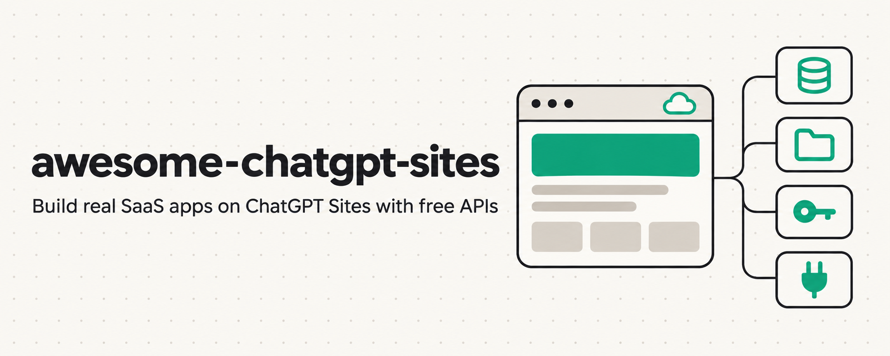
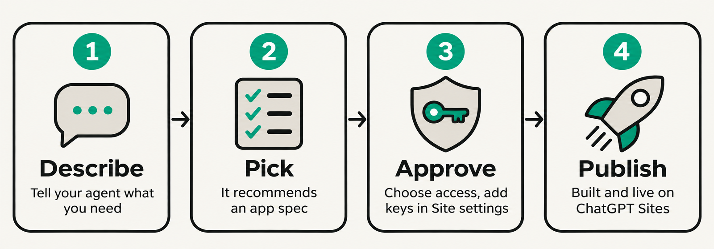
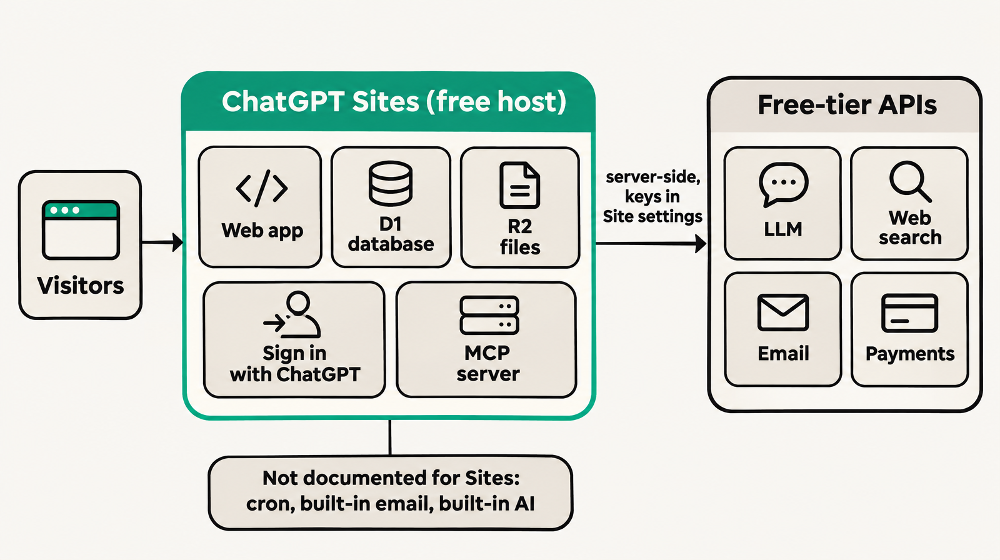

<p align="center">
  
</p>

<p align="center"><a href="README.md">English</a> | <a href="README.ko.md">한국어</a> | <a href="README.ja.md">日本語</a> | <b>简体中文</b></p>

<p align="center">
  
  
  
  <a href="CONTRIBUTING.md"></a>
</p>

**告诉你的编程智能体需要什么 SaaS。它会选出现成的规格，带你申请免费 API 密钥，并发布到 ChatGPT Sites。**

面向 [ChatGPT Sites](https://learn.chatgpt.com/docs/sites) 的应用构建技能合集。Sites 是 OpenAI 为在 ChatGPT 和 Codex 中创建的网站提供的托管服务。（这不是 ChatGPT 镜像站列表。）

## 快速开始：让智能体帮你安装

把下面这段粘贴给 Codex（或任何带有官方 Sites 技能的智能体），它会替你完成安装。 提示词保持英文原样粘贴即可。

```text
Install the "awesome-sites" skill from https://github.com/Atipico1/awesome-chatgpt-sites into this agent.

1. Clone the repository into a temporary folder.
2. Copy only the folder skills/awesome-sites into this agent's skills directory
   (Codex: ~/.codex/skills/, Claude Code: ~/.claude/skills/). Keep its references/ folder inside it.
3. Confirm that <skills directory>/awesome-sites/SKILL.md and awesome-sites/references/apps/ exist, then delete the temporary clone.
4. Check that the official ChatGPT Sites skill or plugin is available to this agent.
   If it is not, tell me how to enable it and stop.
5. Tell me whether I must restart the agent to load new skills, and show me one example request to try.
```

### 然后说出你的需求

用日常语言描述想要的工具。例如：

- "帮我在 Sites 上做一个给我 SaaS 用的反馈看板。"
- "在 Sites 上有哪些东西可以免费做？"
- "做一个把会议录音整理成行动项的工具。"

## 工作方式

<p align="center">
  
</p>

1. **你描述需求。** 技能从下面的规格中匹配一个，并说明运行成本。
2. **动手前先征求同意。** 你批准谁能打开网站、需要什么登录、是否绑定自定义域名、使用哪些 API 密钥、保存哪些访客数据。
3. **分步指导获取密钥**（链接、点击顺序、密钥名称）。密钥填在网站设置里，不要发在聊天中。
4. **由官方 Sites 技能构建并发布。** 规格固定了数据模型、路由、页面、限额和验证步骤。

## 应用列表

共 31 个规格，每个是 [`skills/awesome-sites/references/apps/`](skills/awesome-sites/references/apps/) 中的一个文件。"所需密钥"指除 Sites 以外需要的密钥，都可以从免费额度开始。

### 面向客户的工具

| 应用 | 功能 | 所需密钥 |
| --- | --- | --- |
| [feedback-board](skills/awesome-sites/references/apps/feedback-board.md) | 客户提交并投票功能需求的看板，附公开路线图 | — |
| [waitlist](skills/awesome-sites/references/apps/waitlist.md) | 上线前邮箱候补名单，邀请链接可提升排名 | — |
| [changelog](skills/awesome-sites/references/apps/changelog.md) | 带 RSS 和嵌入组件的更新日志页 | — |
| [form-backend](skills/awesome-sites/references/apps/form-backend.md) | 表单构建器与收件箱，可接收任意 HTML 表单提交 | — |
| [testimonials](skills/awesome-sites/references/apps/testimonials.md) | 收集客户评价并展示"好评墙" | — |
| [booking](skills/awesome-sites/references/apps/booking.md) | 设置每周可约时间，对方自行选时间预约（无日历同步） | — |
| [link-shortener](skills/awesome-sites/references/apps/link-shortener.md) | 带点击统计和二维码的短链接 | — |
| [link-in-bio](skills/awesome-sites/references/apps/link-in-bio.md) | 带主题和点击统计的链接聚合页 | — |
| [email-signature](skills/awesome-sites/references/apps/email-signature.md) | 可复制粘贴的 HTML 邮件签名生成器，含团队模式 | — |

### 文件与支付

| 应用 | 功能 | 所需密钥 |
| --- | --- | --- |
| [file-transfer](skills/awesome-sites/references/apps/file-transfer.md) | 上传文件，生成带有效期和密码的分享链接 | — |
| [doc-sharing](skills/awesome-sites/references/apps/doc-sharing.md) | 可追踪的 PDF 链接：谁看了、每页停留多久 | — |
| [invoicing](skills/awesome-sites/references/apps/invoicing.md) | 带公开支付页和 Stripe Checkout 的发票 | Stripe |
| [digital-storefront](skills/awesome-sites/references/apps/digital-storefront.md) | 用 Stripe 销售 PDF、模板等数字商品 | Stripe |

### AI 与网络数据工具

| 应用 | 功能 | 所需密钥 |
| --- | --- | --- |
| [formula-ai](skills/awesome-sites/references/apps/formula-ai.md) | 用自然语言生成 Excel/表格公式、SQL、正则 | LLM |
| [research-briefs](skills/awesome-sites/references/apps/research-briefs.md) | 联网搜索并撰写带引用来源的报告 | Tavily + LLM |
| [csv-enricher](skills/awesome-sites/references/apps/csv-enricher.md) | 用联网搜索补全 CSV 的新列 | Tavily + LLM |
| [bookmarks-mcp](skills/awesome-sites/references/apps/bookmarks-mcp.md) | 带 AI 摘要的书签，可通过 MCP 在 ChatGPT 中搜索 | — (LLM optional) |
| [meeting-notes](skills/awesome-sites/references/apps/meeting-notes.md) | 录音转文字、摘要和行动项 | Groq + LLM |
| [resume-tailor](skills/awesome-sites/references/apps/resume-tailor.md) | 根据职位描述定制简历和求职信 | LLM |
| [docs-chatbot](skills/awesome-sites/references/apps/docs-chatbot.md) | 基于你文档回答的客服机器人，可嵌入网站 | LLM |
| [seo-audit](skills/awesome-sites/references/apps/seo-audit.md) | PageSpeed 评分与页面 SEO 检查清单 | PageSpeed key |
| [receipt-tracker](skills/awesome-sites/references/apps/receipt-tracker.md) | 收据照片转为费用台账，可导出 CSV | Gemini key |
| [feedback-analyzer](skills/awesome-sites/references/apps/feedback-analyzer.md) | 将评论和问卷归类为主题并分析情感 | LLM |
| [snippet-library](skills/awesome-sites/references/apps/snippet-library.md) | 带变量的文本与提示词库，支持 MCP | — (LLM optional) |
| [review-reply-drafter](skills/awesome-sites/references/apps/review-reply-drafter.md) | 粘贴客户评论，生成 3 条回复草稿（不自动发布） | LLM |

### 韩国市场工具（界面为韩语）

| 应用 | 功能 | 所需密钥 |
| --- | --- | --- |
| [group-order-ledger](skills/awesome-sites/references/apps/group-order-ledger.md) | 把 KakaoTalk 团购聊天整理成订单表并核对入账（仅记录） | LLM |
| [order-sheet-converter](skills/awesome-sites/references/apps/order-sheet-converter.md) | 把电商订单表合并为快递上传格式（仅在浏览器内处理） | — |
| [campaign-tracker](skills/awesome-sites/references/apps/campaign-tracker.md) | 体验团/赞助合作的日程管理，附日历订阅 | — (LLM optional) |
| [club-ledger](skills/awesome-sites/references/apps/club-ledger.md) | 社团会费、出勤、罚款、排名记录（不经手资金） | — |

### 团队与智能体工具

| 应用 | 功能 | 所需密钥 |
| --- | --- | --- |
| [issue-tracker](skills/awesome-sites/references/apps/issue-tracker.md) | 带 MCP 工具的 Linear 风格问题看板 | — |
| [memory-mcp](skills/awesome-sites/references/apps/memory-mcp.md) | ChatGPT 与 Codex 可通过 MCP 读写的个人记忆 | — |

## Sites 提供什么，你需要自带什么

<p align="center">
  
</p>

Sites 提供免费托管、数据库（D1）、文件存储（R2）、登录（Sign in with ChatGPT）和 MCP 服务器。AI、搜索、邮件和支付来自有免费额度的外部 API，由服务器端调用，密钥保存在网站设置中。Sites 文档中没有定时任务、内置邮件和内置 AI，因此没有任何规格依赖它们。

### 可指导申请的免费 API 密钥

| 服务 | 用途 | 免费额度（2026-11 核对） | 获取密钥 |
| --- | --- | --- | --- |
| Groq | LLM、语音转文字 | 大模型每天约 1,000 次，Whisper 每小时约 7,200 秒 | [console.groq.com/keys](https://console.groq.com/keys) |
| Gemini | LLM、收据图像识别 | 仅部分模型免费，每日额度较小；免费输入可能被 Google 使用 | [aistudio.google.com/apikey](https://aistudio.google.com/apikey) |
| Cloudflare Workers AI | LLM、向量嵌入 | 每天 10,000 neurons | [dash.cloudflare.com](https://dash.cloudflare.com) |
| Tavily | 联网搜索 | 每月 1,000 积分 | [app.tavily.com](https://app.tavily.com) |
| Jina Reader | 网址转 Markdown | 无需密钥即可使用，速率限制较低 | [jina.ai/reader](https://jina.ai/reader/) |
| PageSpeed Insights | SEO 检测 | 免费，必须有密钥，通常每天 25,000 次 | [Google Cloud Console](https://console.cloud.google.com) |
| Resend | 邮件（可选） | 每月 3,000 封、每天 100 封；发给其他收件人需验证域名 | [resend.com/api-keys](https://resend.com/api-keys) |
| Stripe | 支付 | 先用测试模式，切换正式密钥由你自己完成 | [dashboard.stripe.com/apikeys](https://dashboard.stripe.com/apikeys) |

额度经常变化。完整步骤、密钥名称和连通性检测见 [`api-keys.md`](skills/awesome-sites/references/shared/api-keys.md)。

## 前提条件

- 带有官方 **Sites** 技能或插件的智能体（按 Codex 编写）
- 有 Sites 权限的 ChatGPT 套餐：Plus、Pro 或符合条件的工作区。Free 和 Go 不可用

## 手动安装

如果想自己动手：

<details>
<summary><b>Codex</b></summary>

```bash
git clone https://github.com/Atipico1/awesome-chatgpt-sites.git
cp -R awesome-chatgpt-sites/skills/awesome-sites ~/.codex/skills/
```

</details>

<details>
<summary><b>Claude Code（需要可用的 Sites 工具）</b></summary>

```bash
git clone https://github.com/Atipico1/awesome-chatgpt-sites.git
cp -R awesome-chatgpt-sites/skills/awesome-sites ~/.claude/skills/
```

</details>

<details>
<summary><b>Skills CLI</b></summary>

```bash
npx skills add Atipico1/awesome-chatgpt-sites --skill awesome-sites
```
请复制整个 `awesome-sites` 文件夹。技能会读取自己 `references/` 目录中的文件。

</details>

## 当前状态

规格已写完并通过校验（`python3 scripts/lint-specs.py`）。尚未把每个规格都在真实 Site 上完整构建一遍。请把每个规格当作扎实的初稿；基于真实构建的反馈和 PR 最有价值。

## 常见问题

<details>
<summary><b>要花钱吗？</b></summary>

Sites 托管在 2026-12-31 前免费。2027-01-01 起，带数据库的网站在计流量之前每月约用 25 积分（Plus 额度为 125）。表中的 API 都有免费额度，而免费额度由所有访客共享，所以规格里加入了按用户限额和缓存。

</details>

<details>
<summary><b>网站能用我的 ChatGPT 订阅来调用 AI 吗？</b></summary>

按文档，Sites 上不行。Sign in with ChatGPT 只给网站访客的邮箱和姓名。应用使用你自己申请的密钥调用外部免费 LLM。

</details>

<details>
<summary><b>API 密钥放在哪里？</b></summary>

放在网站设置中（ChatGPT → Sites → 对应网站 → 更多操作 → 设置）。Sites 指南要求不要把密钥放进提示词和文件。技能会告诉你准确的密钥名称。

</details>

<details>
<summary><b>客户没有 ChatGPT 账号也能用吗？</b></summary>

把网站受众设为公开即可。技能会在构建前询问你，绝不擅自更改受众。需要登录的功能只能用 ChatGPT 账号登录。

</details>

<details>
<summary><b>规格为什么这么详细？</b></summary>

为了让智能体不必自行决定产品行为：数据表、路由、限额和验证步骤都固定在规格里。

</details>

## 参与贡献

欢迎提交新的应用规格：有真实需求、适配 Sites、可在免费额度内运行。请先阅读 [CONTRIBUTING.md](CONTRIBUTING.md)，提 PR 前运行 `python3 scripts/lint-specs.py`。每个应用入选的原因以及被排除的想法见 [docs/demand-evidence.md](docs/demand-evidence.md)。

## 参考文档

- [规格模板](skills/awesome-sites/references/shared/spec-template.md)
- [平台基础规则](skills/awesome-sites/references/shared/baseline.md)
- [受众、登录与自定义域名](skills/awesome-sites/references/shared/access-and-domains.md)
- [免费 API 用量保护](skills/awesome-sites/references/shared/usage-guard.md)
